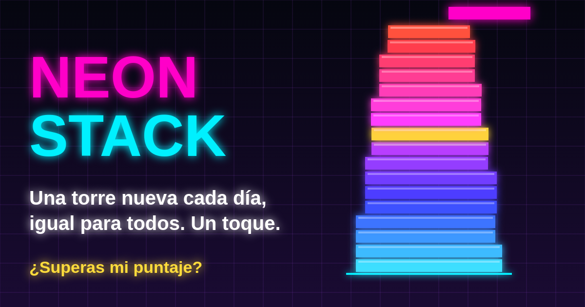

# Neon Stack

**Una torre nueva cada día, igual para todos.** Juego de un toque para el navegador, de código abierto, hecho con
JavaScript, CSS y HTML puros: sin frameworks, sin paso de compilación, sin registro.

- **Jugar:** [games.johnandrestrujillo.com/play/neon-stack](https://games.johnandrestrujillo.com/play/neon-stack)
- **Controles:** toca, haz clic o pulsa Espacio para soltar el bloque; Esc o P para pausar.

*English: a one-tap stacking game with one tower of the day, the same for everyone. Open-source browser game in plain
JavaScript. Add `?lang=en` for English.*



## Cómo se juega

Un bloque se desliza sobre la torre. Al tocar, cae: lo que sobresale del piso de abajo se corta y la torre se hace más
angosta. Si cae casi exacto (4 px o menos) es **perfecto**: no se corta, suma más y, desde el cuarto perfecto seguido, el
bloque vuelve a crecer. Si no toca el piso de abajo, la torre termina.

## Qué tiene

- **Torre del día.** La fecha decide la velocidad de cada piso, el lado por el que entra y cuáles son **bloques dorados**
  (puntos dobles). Todos juegan la misma torre ese día. Detalles en [docs/DAILY.md](docs/DAILY.md).
- **Reta a alguien.** El resultado se comparte con un enlace que lleva la misma torre y tu puntaje como meta.
- **Hecho para el teléfono.** Vertical, un dedo, partidas de menos de un minuto, física a 120 pasos por segundo.
- **Al perder, la cámara se aleja** y muestra la torre entera.
- **Español e inglés. Medición anónima** sin cookies ni identificadores, que respeta "Do Not Track".

## Probarlo en tu máquina

```
python3 -m http.server 8000
```

y abre <http://localhost:8000>. Para jugar la torre de otro día: `?debug=true&day=2026-11-30`.
Pruebas (Playwright): `tests/smoke.py`; el bot: `tests/autoplayer.js` y `tests/bot_runs.py`.

## Créditos y licencia

Código original de John Andrés Trujillo, publicado con [licencia MIT](LICENSE). El reto diario, la forma de compartir y
la medición vienen de sus juegos hermanos [Neon Raiders](https://github.com/jatezzz/neon-raiders) y
[Neon Bricks](https://github.com/jatezzz/neon-bricks). Los sonidos se sintetizan en el navegador. Este proyecto no está
afiliado ni respaldado por los dueños de ningún juego ni de sus marcas.
